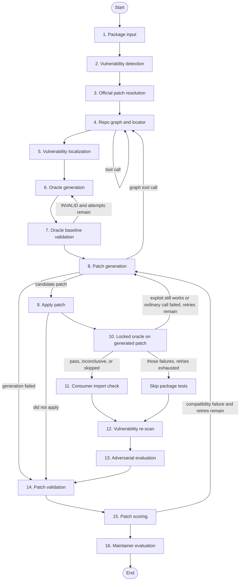

# Pipeline Flow and Validation Design

## Purpose

This project evaluates whether an LLM can generate a source-code security patch for a vulnerable npm package without breaking the package. It uses a LangGraph state machine to download a specified package version, identify known vulnerabilities, locate the relevant code, generate a security oracle, generate and validate a patch, and record the outcome.

The pipeline separates three questions:

1. **Can an oracle tell the vulnerable package from the maintainer fix?** The oracle must exploit the vulnerable version and leave the maintainer-fixed version unexploited, with the ordinary operation completing on both.
2. **Does the generated patch block that oracle?** The accepted oracle is re-run against the patched package.
3. **Does the patch still load as a package?** The vulnerable package and the patched package are installed and imported as consumers.

## Workflow Overview



The shared `GraphState` carries the package metadata, findings, source paths, locator results, oracle, generated patch, validation evidence, evaluator verdict, answer key, errors, and retry count between stages.

## Stage-by-Stage Flow

### 1. Package input

**Module:** `package_input.py`

The user provides a package name and version, for example `lodash@4.17.15`.

- If `--source-dir` is supplied, the pipeline uses that already-extracted source directory.
- Otherwise, it runs `npm pack <package>@<version>` and extracts the resulting tarball into `.workspace/packages/`.
- Archive extraction excludes symbolic links and entries that could escape the extraction directory.
- The resulting source directory and `package.json` path are saved into the graph state.

### 2. Vulnerability detection

**Module:** `vulnerability_detection.py`

The pipeline identifies known vulnerabilities for the exact package version.

1. It creates an SBOM with **Syft** and scans it with **Grype**.
2. It first scans the extracted package source directly.
3. If the target package/version is not identified, it creates an isolated npm lockfile project pinned to that package version and scans that.
4. If necessary, it falls back to `npm audit`.

The findings matching the target package are placed in `current_vulnerabilities`. Scan artifacts are retained for traceability.

### 3. Official patch resolution (answer key)

**Module:** `og_patch_resolution.py`

For the detected GHSA or CVE, the pipeline queries the GitHub Advisory API and attempts to locate a referenced maintainer commit. It stores the advisory metadata, commit references, changed files, and maintainer diff as an **answer key**.

The patch generator does not receive this answer key. Oracle generation does: the oracle has to be checked against the maintainer-fixed package, so it receives the advisory, the fixed version, and the maintainer diff.

### 4. Repo graph and locator

**Modules:** `repo_graph.py`, `locator.py`

The pipeline builds a package graph of files, symbols, imports, and calls. The locator searches that graph with `SearchEntity`, `TraverseGraph`, and `RetrieveEntity`, then ranks vulnerable locations. Tool calls loop between the locator and the repo graph. A finished ranking continues to vulnerability localization. The located function bodies are kept in `debug_locations` for the patch writer.

### 5. Vulnerability localization

**Module:** `vulnerability_localization.py`

This stage selects source files and builds focused excerpts for the oracle prompt:

```text
[{"path": "relative/path.js", "content": "excerpt"}]
```

The patch writer prefers `debug_locations` when those bodies exist, and falls back to these excerpts.

### 6. Oracle generation

**Module:** `oracle_generation.py`

The model returns one JSON object with a CommonJS `source` script, an explanation, and a list of trusted fixture names. The script must print a final line:

```text
ORACLE_RESULT {"operation_completed": true, "exploit_succeeded": false, "evidence": "..."}
```

The harness owns Docker setup. The script may require the target package and `node:fs`, `node:path`, and `node:os`. A static check rejects source that directly references process, network, or worker modules. The package under test can still use those APIs inside the container.

### 7. Oracle baseline validation

**Module:** `oracle_validation.py`

The candidate runs in Docker against two packages:

- the vulnerable package must finish the ordinary operation and report `EXPLOIT_SUCCEEDED`;
- the maintainer-fixed package must finish the ordinary operation and report `EXPLOIT_BLOCKED`.

The runtime container has no network, a read-only root filesystem, a small writable `/tmp`, user `node`, all capabilities dropped, and process, memory, and CPU limits. The host reads the last `ORACLE_RESULT` line from stdout. The process exit code is not the verdict. A crash or a failed ordinary call is rejected rather than treated as a blocked exploit.

An `INVALID` oracle is sent back to generation until `max_oracle_attempts` is reached. The default is 5. A valid oracle is stored as `accepted_oracle`. A skipped oracle, an error, or an exhausted budget still continues to patch generation, without an accepted oracle.

### 8. Patch generation and source preflight

**Module:** `patch_generation.py`

The selected patch-generator model receives:

- package name and version;
- the selected vulnerability details;
- bounded excerpts from the located source; and
- the required structured-edit response schema.

The preferred response format is:

```json
{
  "edits": [
    {
      "path": "relative/path/to/source.js",
      "old_text": "exact source text from the supplied context",
      "new_text": "replacement source text"
    }
  ]
}
```

The generator may instead request one graph tool: `SearchEntity`, `TraverseGraph`, or `RetrieveEntity`. That request loops back to the repo graph, and the tool result returns to patch generation. The writer may do this up to three times. The generator is instructed to make a minimal source-level fix and not modify version metadata, dependencies, lockfiles, or tests.

#### Generation checks

Before any container is built, the pipeline performs the following deterministic checks:

1. The response must contain a complete edit list.
2. The target path must be a real, safe source file inside the package. Paths outside the package, `node_modules`, manifest/lockfiles, and test directories are rejected.
3. Each `old_text` value must occur **exactly once** in the real source file.
4. The replacement must make a real change, rather than a no-op.
5. The pipeline materialises a unified diff itself from accepted structured edits.
6. It runs `git apply --check --recount` against a temporary copy of the original source.

If the model returns malformed output, an edit that does not match the source, or a diff that cannot be applied, it receives the validation error and gets one repair attempt. If that also fails, `current_patch` is cleared and the candidate is classified as a generation failure; no Docker sandbox is run.

### 9. Apply patch

**Module:** `patch_application.py` (`apply_patch`)

For a preflight-approved patch, the pipeline writes the diff into a temporary workspace copied from the original source. The original downloaded source is not modified. Package checks do not run yet. A patch that does not apply skips the oracle and goes to classification.

### 10. Locked oracle on the generated patch

**Module:** `oracle_validation.py` (`generated_patch_oracle_validation`)

The accepted oracle is run, unchanged, against the patched package.

| Oracle result | Next step |
| --- | --- |
| `SECURITY_PASS` — exploit blocked | Consumer import check |
| `SECURITY_FAIL` — exploit still succeeds | Another patch, while writer retries remain |
| `REGRESSION` — ordinary operation failed | Same retry path |
| `INCONCLUSIVE` or `SKIPPED` | Consumer import check; the writer is not retried for the oracle |

When the writer is out of retries, package checks are skipped. A new patch attempt clears the previous oracle verdict. The accepted oracle itself stays locked.

### 11. Consumer import check

**Module:** `patch_application.py` (`package_validation`)

The published package is checked as a consumer, not by running repository `npm test`. Repository tests are not assumed to be present in the npm artifact.

For the untouched vulnerable package and the patched package, the sandbox:

1. Builds a Docker image from the package files.
2. Installs dependencies with `npm install`.
3. Imports the package with `node`.

Regression status compares those two consumer runs. `NO_REGRESSION` means both imported. `REGRESSION` means the baseline imported and the patched package did not. Dependency and image-setup failures are infrastructure failures and do not request another source patch.

### 12. Vulnerability re-scan

**Module:** `vulnerability_rescan.py`

The patched workspace is scanned again with Syft and Grype. Findings are filtered to the advisory IDs that existed before patching and stored as `remaining_vulnerabilities`.

This is useful diagnostic evidence, but it is **not a pass/fail gate**. Package scanners generally identify installed package versions, not the behaviour of a local source-code patch. Therefore, an unchanged version can continue to be reported even when a source-level fix is correct.

The patched workspace is removed after this stage.

### 13. Independent adversarial evaluation

**Module:** `adversarial_evaluation.py`

The pipeline uses the other configured model as an independent evaluator:

- GPT-5.3-Codex generator → Claude Sonnet 5 evaluator
- Claude Sonnet 5 generator → GPT-5.3-Codex evaluator

The evaluator receives the vulnerability details, generated patch, validation results, validation-log excerpt, and re-scan information. It returns a JSON verdict:

```json
{
  "genuine_fix": "true | false | uncertain",
  "reasoning": "brief evidence-based explanation",
  "evidence": ["specific observations"]
}
```

It is explicitly instructed not to use the version-based re-scan result as proof that a source patch succeeded or failed. An unavailable or invalid evaluator response is recorded as `uncertain`; it does not override deterministic validation.

### 14. Patch validation and persistence

**Module:** `patch_validation.py`

The pipeline sets the main classification from compatibility and the locked oracle:

| Condition | Classification |
| --- | --- |
| Consumer check passes and the locked oracle returns `SECURITY_PASS` | `pass` |
| Consumer check passes, but the oracle was skipped or inconclusive | `inconclusive` |
| Consumer regression, security failure, or incomplete compatibility validation | `fail` |

An inconclusive security result is not retried. A compatibility failure is retried while writer attempts remain. Setup and dependency failures go to evaluation without another patch.

Every result is saved to MongoDB in `all_attempts`. A passing result is also saved in the success collection. The recorded document includes the patch, validation logs, re-scan evidence, adversarial evaluation, errors, and later scoring result.

### 15. Patch scoring against the maintainer fix

**Module:** `patch_scoring.py`

If an official answer-key patch was resolved, the pipeline compares it with the generated patch. The score reports:

- **Location:** whether the changed files and hunks are the same, overlapping, or different.
- **Strategy:** whether both patches appear to use the same, similar, or different remediation approach.
- **Completeness:** whether the generated patch covers the maintainer patch's relevant hunks.

This score is an evaluation metric only. It does not change the classification.

### 16. Maintainer evaluation

**Module:** `maintainer_eval.py`

A model compares the generated diff with the maintainer diff and returns a qualitative verdict. This runs after scoring, including when the run stops for a pass, an inconclusive oracle, an infrastructure failure, or an exhausted retry budget. It does not change the classification.

## Isolated runners

`isolated_runners/_config.json` supplies the package, version, optional source directory, optional vulnerability id, provider, and model.

`isolate_locator.py` runs package input, vulnerability detection, official-patch resolution, the repo graph, and the locator. It stops once files are ranked.

`isolate_oracle.py` runs package input, vulnerability detection, official-patch resolution, oracle generation, and oracle baseline validation. It does not locate files or generate a patch. An invalid oracle is corrected inside that run, using the same attempt budget as the graph.

Each oracle invocation writes a new directory:

```text
isolated_runners/generated_oracles/<package>_<version>_<N>/
```

`<N>` starts at 1 for that package version and increments. A different model, or the same model run again, keeps a separate script. The directory contains `oracle.js` for the final candidate, `attempt-<N>.js` for each generated script, and `result.json` for the model, validation status, and per-attempt outcome. The process exits non-zero when the final baseline status is not `VALID`.

Run it from the `FYP` directory:

```text
python isolated_runners/isolate_oracle.py
```

## Retry Behaviour

Oracle generation has its own budget, `max_oracle_attempts`, default **5**. Those attempts correct the oracle. They do not consume patch-writer retries.

After scoring, a passing attempt ends the workflow. A failed compatibility attempt is retried until `max_retries` is reached. The default is **one retry (two total patch attempts)**; both runners accept `--max-retries`, with `MAX_RETRIES` as the environment default. Set zero to disable patch retries. Generation's internal repair calls do not consume patch retries. A locked-oracle `SECURITY_FAIL` or `REGRESSION` uses this same writer budget and skips the consumer check until a later candidate passes the oracle or the budget is exhausted.

Every failed classification, including an exhausted final attempt, produces structured retry feedback. Generation receives the failed candidate, failure stage, classification reason, attempt-local errors, and bounded validation logs. Patch application captures command diagnostics. Each generation clears previous sandbox, scan, evaluator, and validation results and starts from the original source. Generation failures receive attempt numbers even when no candidate exists.

`failure_context.py` stores package history under `failure_context/<safe-package-name>-<name-hash>/`:

- `failures.jsonl` retains the full structured failure archive, including internal generation repair failures. The archive is not read to construct prompts.
- `<version>-<hash>/<vulnerability-id>-<hash>/context.md` is the editable persistent prompt input. There is one file per package version and advisory/alias. All-scope runs load the files for all selected findings; duplicate automatic records across aliases are removed from the prompt.

For example, a shell-quote run loads `failure_context/shell-quote-f770cd4f5b/1.8.3-<hash>/GHSA-w7jw-789q-3m8p-<hash>/context.md` alongside its baseline prompt. Manual changes to that Markdown affect future prompts directly. On failure, the pipeline appends a bounded, readable evidence block with a record marker; it never rewrites existing text. Removing an old block or correcting its wording is preserved. JSONL remains the full archive. Keep record markers when editing a block if you want automatic duplicate detection.

Prompt sections contain persistent Markdown first and the latest attempt's failure separately for immediate retries. Automatic blocks from the current run are excluded from persistent prompt memory to avoid repeating the latest failure. Their files remain available to future runs. A shared 18,000-character budget prioritizes immediate feedback, and oversized Markdown is explicitly truncated only in the prompt; the file remains intact. OpenRouter receives this alongside the baseline template; other providers receive it in their structured user payload. Internal repair prompts retain this context.

Error windows and final test output take priority over Docker progress. Infrastructure failures do not establish a source defect. Detailed evaluator reasoning remains in JSONL; its verdict is labeled as an unverified opinion. Official answer-key patches and comparison scores are excluded. Storage failures warn without aborting; immediate feedback can still be passed from state if a file cannot be written.

History is eligible for Git tracking under top-level `failure_context/`. Common credentials and service identifiers are redacted. Existing archived shell-quote failures have been seeded into scoped Markdown files without replacing existing files. The old package-level `context.md` and ignored `.workspace` copies are retained as legacy backups and are no longer loaded or updated. Tests use temporary history directories. Normal package extraction does not remove history.

## Interpretation of Results

| Evidence | What it establishes | What it does not establish |
| --- | --- | --- |
| Oracle baseline `VALID` | The script exploits the vulnerable package and the ordinary operation still completes on the maintainer-fixed package | That the script checks the intended bug rather than some other difference |
| Locked oracle `SECURITY_PASS` | That script's exploit no longer succeeds on the generated patch | That every vulnerable path is fixed |
| Exact `old_text` match and diff preflight | The candidate is based on the real source and can apply cleanly | That the security logic is correct |
| Consumer import check | The patched package still installs and imports | That repository tests pass or that the vulnerable path is fixed |
| Vulnerability re-scan | Known advisory IDs still visible to the scanner | Whether a local source patch is effective |
| Adversarial evaluation | An independent evidence-based assessment of the security logic | A formal proof of security |
| Maintainer-patch score and maintainer evaluation | Similarity to the published remediation | That a different patch cannot also be correct |

A classification of `pass` means the locked oracle was blocked and the consumer import check found no regression. `inconclusive` means the package still imported, but no accepted oracle judged the patch.
