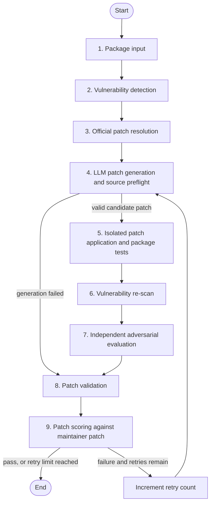

# Pipeline Flow and Validation Design

## Purpose

This project evaluates whether an LLM can generate a source-code security patch for a vulnerable npm package without breaking the package. It uses a LangGraph state machine to download a specified package version, identify known vulnerabilities, generate and validate a patch, and record the outcome.

The pipeline separates two questions that are easy to confuse:

1. **Is the patch technically usable?** It must match the real source, apply cleanly, build, and pass the package tests.
2. **Is the patch likely a genuine security fix?** A separate model evaluates the patch against the advisory and the changed code. When available, the patch is also compared with the maintainer's published fix.

## Workflow Overview



The shared `GraphState` carries the package metadata, findings, source paths, generated patch, validation evidence, evaluator verdict, answer key, errors, and retry count between stages.

## Stage-by-Stage Flow

### 1. Package input

**Module:** `package_input.py`

The user provides a package name and version, for example `lodash@4.17.15`.

- If `--source-dir` is supplied, the pipeline uses that already-extracted source directory.
- Otherwise, it runs `npm pack <package>@<version>` and extracts the resulting tarball into `.workspace/packages/`.
- Archive extraction excludes symbolic links and entries that could escape the extraction directory.
- The resulting source directory and `package.json` path are saved into the graph state.

### 2. Vulnerability detection

**Module:** `vulnerability_detection.py`

The pipeline identifies known vulnerabilities for the exact package version.

1. It creates an SBOM with **Syft** and scans it with **Grype**.
2. It first scans the extracted package source directly.
3. If the target package/version is not identified, it creates an isolated npm lockfile project pinned to that package version and scans that.
4. If necessary, it falls back to `npm audit`.

The findings matching the target package are placed in `current_vulnerabilities`. Scan artifacts are retained for traceability.

### 3. Official patch resolution (answer key)

**Module:** `og_patch_resolution.py`

For the detected GHSA or CVE, the pipeline queries the GitHub Advisory API and attempts to locate a referenced maintainer commit. It stores the advisory metadata, commit references, changed files, and maintainer diff as an **answer key**.

This data is intentionally **not passed to the patch generator**. It is used only after generation to assess how closely the generated patch aligns with the official remediation.

### 4. LLM patch generation and source preflight

**Module:** `patch_generation.py`

The selected patch-generator model receives:

- package name and version;
- the selected vulnerability details;
- bounded excerpts from relevant package source files; and
- the required structured-edit response schema.

The preferred response format is:

```json
{
  "edits": [
    {
      "path": "relative/path/to/source.js",
      "old_text": "exact source text from the supplied context",
      "new_text": "replacement source text"
    }
  ]
}
```

The generator is instructed to make a minimal source-level fix and not modify version metadata, dependencies, lockfiles, or tests.

#### Generation checks

Before any container is built, the pipeline performs the following deterministic checks:

1. The response must contain a complete edit list.
2. The target path must be a real, safe source file inside the package. Paths outside the package, `node_modules`, manifest/lockfiles, and test directories are rejected.
3. Each `old_text` value must occur **exactly once** in the real source file.
4. The replacement must make a real change, rather than a no-op.
5. The pipeline materialises a unified diff itself from accepted structured edits.
6. It runs `git apply --check --recount` against a temporary copy of the original source.

If the model returns malformed output, an edit that does not match the source, or a diff that cannot be applied, it receives the validation error and gets one repair attempt. If that also fails, `current_patch` is cleared and the candidate is classified as a generation failure; no Docker sandbox is run.

### 5. Isolated patch application and package tests

**Module:** `patch_application.py`

For a preflight-approved patch, the pipeline creates a temporary workspace from the original source and applies the diff there. The original downloaded source is not modified.

The workspace is validated in a Docker sandbox:

1. Build the Docker image, installing Git with `apk add --no-cache git`.
2. Install dependencies once during that build with `npm install --include=dev --prefer-offline --no-audit`. Installation must succeed; its exit code is captured in build logs. The subsequent test container uses these installed dependencies.
3. Run the package's `npm test` command, or a load/smoke test when appropriate.
4. Capture logs and clean up the container and image while preserving the patched workspace temporarily for the next stage.

The primary deterministic validation result is:

```text
pass = Docker build succeeded AND package tests passed
```

Dependency installation failures stop image creation and skip tests. They are classified as dependency setup failures. Other Docker image setup failures are classified separately. Both stop the run without requesting another source patch, because changing package source cannot repair sandbox setup. Known npm DNS/network errors during validation are also reported as setup failures; the package scripts remain unchanged and test networking remains disabled. Source application and actual test failures retain the normal retry policy.

### 6. Vulnerability re-scan

**Module:** `vulnerability_rescan.py`

The patched workspace is scanned again with Syft and Grype. Findings are filtered to the advisory IDs that existed before patching and stored as `remaining_vulnerabilities`.

This is useful diagnostic evidence, but it is **not a pass/fail gate**. Package scanners generally identify installed package versions, not the behaviour of a local source-code patch. Therefore, an unchanged version can continue to be reported even when a source-level fix is correct.

The patched workspace is removed after this stage.

### 7. Independent adversarial evaluation

**Module:** `adversarial_evaluation.py`

The pipeline uses the other configured model as an independent evaluator:

- GPT-5.3-Codex generator → Claude Sonnet 5 evaluator
- Claude Sonnet 5 generator → GPT-5.3-Codex evaluator

The evaluator receives the vulnerability details, generated patch, build/test results, validation-log excerpt, and re-scan information. It returns a JSON verdict:

```json
{
  "genuine_fix": "true | false | uncertain",
  "reasoning": "brief evidence-based explanation",
  "evidence": ["specific observations"]
}
```

It is explicitly instructed not to use the version-based re-scan result as proof that a source patch succeeded or failed. An unavailable or invalid evaluator response is recorded as `uncertain`; it does not override deterministic validation.

### 8. Patch validation and persistence

**Module:** `patch_validation.py`

The pipeline sets the main classification:

| Condition | Classification |
| --- | --- |
| Docker build passes and package tests pass | `pass` |
| Generation failed, build failed, or tests failed | `fail` |

Every result is saved to MongoDB in `all_attempts`. A passing build-and-test result is also saved in the success collection. The recorded document includes the patch, validation logs, re-scan evidence, adversarial evaluation, errors, and later scoring result.

### 9. Patch scoring against the maintainer fix

**Module:** `patch_scoring.py`

If an official answer-key patch was resolved, the pipeline compares it with the generated patch. The score reports:

- **Location:** whether the changed files and hunks are the same, overlapping, or different.
- **Strategy:** whether both patches appear to use the same, similar, or different remediation approach.
- **Completeness:** whether the generated patch covers the maintainer patch's relevant hunks.

This score is an evaluation metric only. It does not change the build-and-test classification.

## Retry Behaviour

After scoring, a passing attempt ends the workflow. A failed attempt is retried until `max_retries` is reached. The default is **one retry (two total pipeline attempts)**; both runners accept `--max-retries`, with `MAX_RETRIES` as the environment default. Set zero to disable pipeline retries. Generation's internal repair calls do not consume pipeline retries.

Every failed classification, including an exhausted final attempt, produces structured retry feedback. Generation receives the failed candidate, failure stage, classification reason, attempt-local errors, and bounded validation logs. Patch application captures command diagnostics. Each generation clears previous sandbox, scan, evaluator, and validation results and starts from the original source. Generation failures receive attempt numbers even when no candidate exists.

`failure_context.py` stores package history under `failure_context/<safe-package-name>-<name-hash>/`:

- `failures.jsonl` retains the full structured failure archive, including internal generation repair failures. The archive is not read to construct prompts.
- `<version>-<hash>/<vulnerability-id>-<hash>/context.md` is the editable persistent prompt input. There is one file per package version and advisory/alias. All-scope runs load the files for all selected findings; duplicate automatic records across aliases are removed from the prompt.

For example, a shell-quote run loads `failure_context/shell-quote-f770cd4f5b/1.8.3-<hash>/GHSA-w7jw-789q-3m8p-<hash>/context.md` alongside its baseline prompt. Manual changes to that Markdown affect future prompts directly. On failure, the pipeline appends a bounded, readable evidence block with a record marker; it never rewrites existing text. Removing an old block or correcting its wording is preserved. JSONL remains the full archive. Keep record markers when editing a block if you want automatic duplicate detection.

Prompt sections contain persistent Markdown first and the latest attempt's failure separately for immediate retries. Automatic blocks from the current run are excluded from persistent prompt memory to avoid repeating the latest failure. Their files remain available to future runs. A shared 18,000-character budget prioritizes immediate feedback, and oversized Markdown is explicitly truncated only in the prompt; the file remains intact. OpenRouter receives this alongside the baseline template; other providers receive it in their structured user payload. Internal repair prompts retain this context.

Error windows and final test output take priority over Docker progress. Infrastructure failures do not establish a source defect. Detailed evaluator reasoning remains in JSONL; its verdict is labeled as an unverified opinion. Official answer-key patches and comparison scores are excluded. Storage failures warn without aborting; immediate feedback can still be passed from state if a file cannot be written.

History is eligible for Git tracking under top-level `failure_context/`. Common credentials and service identifiers are redacted. Existing archived shell-quote failures have been seeded into scoped Markdown files without replacing existing files. The old package-level `context.md` and ignored `.workspace` copies are retained as legacy backups and are no longer loaded or updated. Tests use temporary history directories. Normal package extraction does not remove history.

## Interpretation of Results

| Evidence | What it establishes | What it does not establish |
| --- | --- | --- |
| Exact `old_text` match and diff preflight | The candidate is based on the real source and can apply cleanly | That the security logic is correct |
| Docker build | The patched package can be built in the sandbox | That all runtime paths work |
| Package tests | Existing tests still pass | That the vulnerable path is tested or fixed |
| Vulnerability re-scan | Known advisory IDs still visible to the scanner | Whether a local source patch is effective |
| Adversarial evaluation | An independent evidence-based assessment of the security logic | A formal proof of security |
| Maintainer-patch score | Similarity to the published remediation | That a different patch cannot also be correct |

Consequently, a `pass` means the generated patch applied, built, and passed the available package tests. The adversarial verdict and maintainer-patch score provide further evidence about whether it is a genuine security remediation. A vulnerability-specific regression or exploit test would provide the strongest additional assurance when one can be constructed for the advisory.
